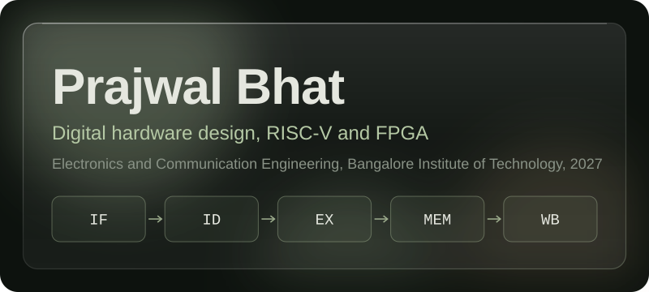
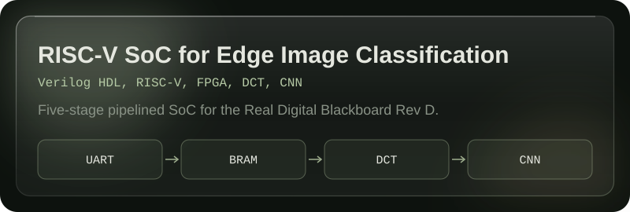
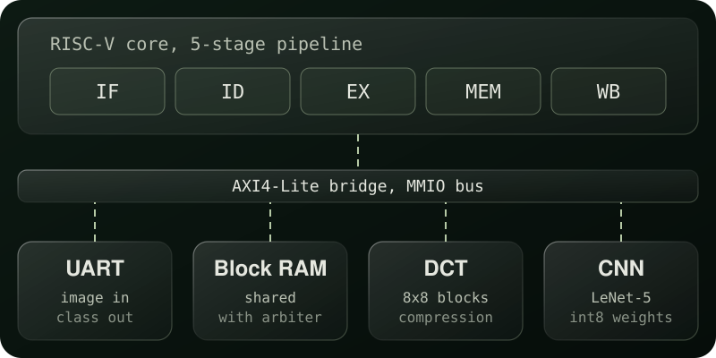
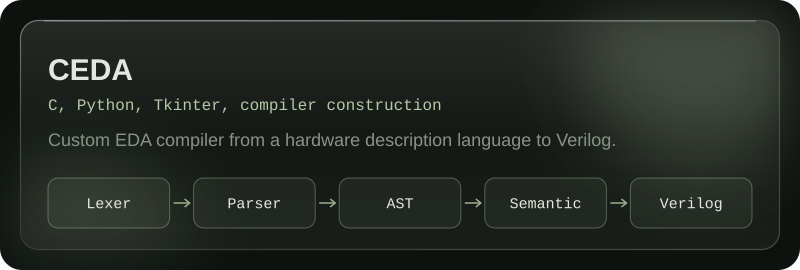
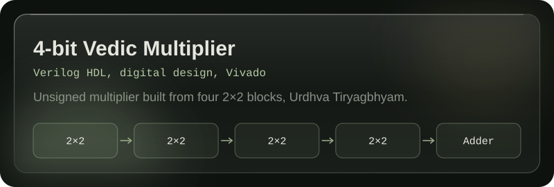
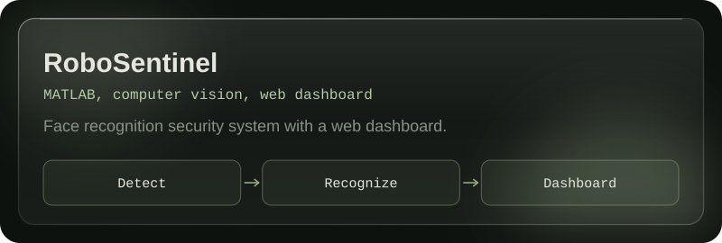

  

 

I am a final-year Electronics and Communication Engineering student at Bangalore Institute of Technology, graduating in 2027. I build digital hardware and the tools around it: a pipelined RISC-V SoC with image accelerators, a compiler from a custom language to Verilog, and ESP32 prototypes.

I am looking for an FPGA internship in RTL design, simulation and verification.

[Portfolio](https://as-prajwal-bhat.github.io/AS_Prajwal_Bhat/) / [Resume](https://as-prajwal-bhat.github.io/AS_Prajwal_Bhat/docs/A_S_Prajwal_Bhat_Resume.pdf) / [LinkedIn](https://www.linkedin.com/in/a-s-prajwal-bhat-aa3717296) / [Email](mailto:prajwalbhat113@gmail.com)

---

## Selected work

A B.E. major project with a team of four, in progress. A 5-stage pipelined RISC-V core with forwarding and hazard handling, memory-mapped peripherals, a frame controller, and hardware DCT and LeNet-5-inspired CNN accelerators sharing one BRAM. It targets the Real Digital Blackboard Rev D (Zynq-7000 XC7Z007S).

Status: the full path runs in Vivado XSim behavioral simulation on a sample digit image. FPGA implementation, timing and resource reports, and hardware validation are still to do. The repository README lists these openly.

Block diagram

 

  

 

A compiler of about 2,300 lines of C that turns a custom hardware description language into synthesizable Verilog: lexer, recursive-descent parser, AST, semantic analysis and code generation. It ships with a CLI, GUI tools and browser-based editors.

 

A hierarchical 4-bit unsigned multiplier based on the Urdhva Tiryagbhyam technique, built from four 2x2 blocks and an adder. Checked against all 256 input combinations in a testbench.

 

A face-recognition security system that detects, recognizes and logs people in real time. MATLAB handles the vision, and a web dashboard shows activity and manages users.

 

Also built: **BIOHAPTIK**, an ESP32 haptic prototype that turns environmental audio and spatial information into vibration signals, and an **ESP32 Vision Rover** with live video, browser control and a telemetry dashboard. More Verilog designs, including a round robin arbiter and a traffic light controller, are on the [portfolio](https://as-prajwal-bhat.github.io/AS_Prajwal_Bhat/).

---

## Toolbox

| | |
|---|---|
| Hardware design | Verilog, RTL, FSM design, testbenches, Xilinx Vivado, EDA Playground |
| VLSI | Cadence Genus and SimVision, NGSpice, Xschem, Magic, Sky130 |
| Embedded | ESP32, ESP32-CAM, 8051, NXP FRDM-MCXN236, UART, SPI, I2C |
| Software | C, C++, Python, SQL, MATLAB, Git, Linux, WSL |

---

## Roles and recognition

- **General Secretary**, IEEE Student Branch, BIT (Aug 2025 to present). Organized workshops on TCL, Linux and VLSI, and led a national-level hackathon with around 80 participants.
- **Secretary**, IEEE CEDA and CAS Societies, BIT (Dec 2025 to present).
- **Placement Coordinator**, BIT.
- **Winner**, IoT and Embedded Systems with ESP32 Hackathon, Exovian Robotics (Oct 2025).
- **RTL to GDSII using Cadence tools**, 5-day industry training (Apr 2026).
- **IoT Intern**, Emertxe, on an Edge AI smart EV charging station optimizer (Aug to Sep 2026).

Certificates and the full list are on the [portfolio](https://as-prajwal-bhat.github.io/AS_Prajwal_Bhat/).

---

Email is the best way to reach me: [prajwalbhat113@gmail.com](mailto:prajwalbhat113@gmail.com). Based in Bengaluru, India.
